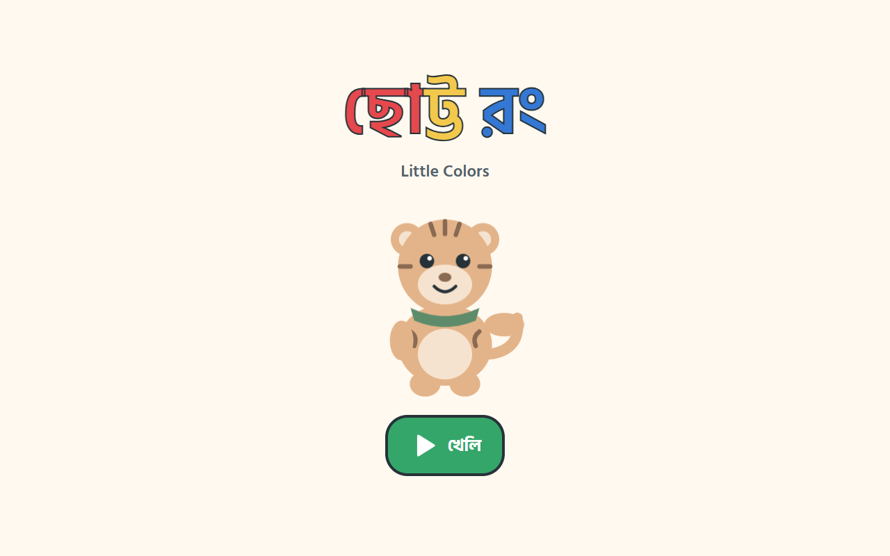
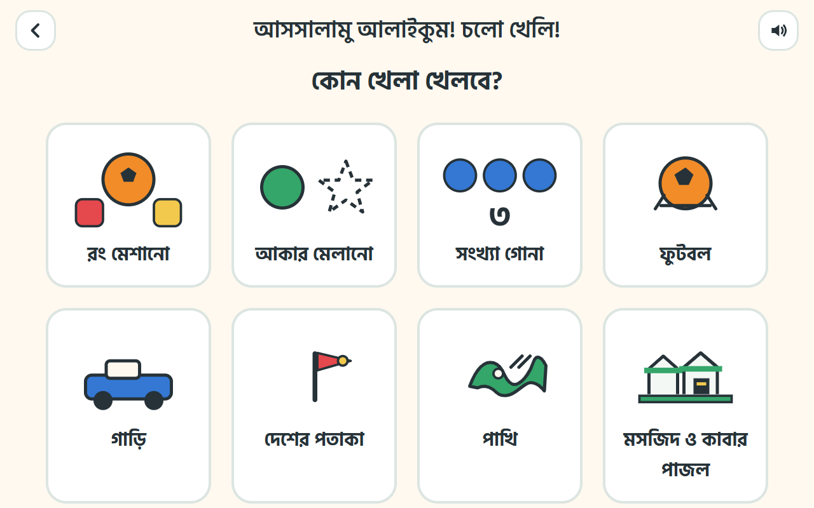

# Rumi Learning Adventures

Offline Bengali and English learning games for children, with a friendly mascot and playful 2D and 3D activities.

[](https://github.com/mhannan-dev/little_colors/actions/workflows/ci.yml)
[](LICENSE)


রুমির শেখার অভিযান brings learning and play together in a Windows desktop app. English is the first-launch default, with Bengali available through the language switcher. The project is under active development. Release preparation and remaining verification are recorded in [the repository audit](docs/repository-audit.md).

The Play menu includes colour mixing, shape matching, letters, counting and simple maths, flags, fruits, flowers, animals, building, everyday habits, driving adventures, and 3D Table Tennis. Categories and search help families find a game. Formula Circuit uses Bevy and Rapier compiled to WebAssembly inside the app window.

## Key features

- Learning activities for letters, numbers, shapes, colours, animals, and everyday habits.
- Bengali and English labels, narration support, and language-aware numerals.
- Large controls with mouse, touch, and keyboard support across activities.
- Procedural Three.js worlds, building games, driving adventures, and table tennis.
- Offline content, recorded-voice support, and placeholder narration fallbacks.
- A searchable game menu and games rendered inside the desktop window.
- Parent-confirmed optional desktop updates through Tauri's updater.

## Architecture

| Layer | Technology | Responsibility |
| --- | --- | --- |
| Desktop shell | Tauri 2 and Rust | Native window, IPC, City Bus Driver state and persistence, updates |
| Screens and controls | Svelte 5, SvelteKit, TypeScript | Navigation, reactive UI, input, settings, and narration |
| 3D activities | Three.js | Procedural scenes, cameras, lighting, and rendering |
| Racing example | Bevy 0.18.1 and bevy_rapier3d 0.33.0 | Standalone racing simulation and embedded WASM target |
| Shared logic | TypeScript workspace packages | Learning rules, game state, storage interfaces, and design tokens |
| Verification | Vitest, TypeScript, svelte-check, Playwright | Unit tests, static checks, and Edge browser tests |

Svelte screens call shared TypeScript rules directly. Native features use Tauri IPC to reach Rust state. Formula Circuit loads its generated WASM in a local frame. The browser preview supports UI development, while native command handlers run in the desktop app.

## Development setup

Run commands from the repository root unless a section says otherwise.

Use Node.js 24 and pnpm 11, matching the Windows release workflow. Desktop development also requires a stable Rust MSVC toolchain with Rust 1.90 or newer, Microsoft C++ Build Tools with the Windows SDK, and Microsoft Edge WebView2 Runtime.

1. Install Git and the tools listed above.
2. Clone the repository and enter its root directory.

   ```powershell
   git clone https://github.com/mhannan-dev/little_colors.git
   cd little_colors
   ```

3. Install dependencies and launch the desktop app.

```powershell
npm install --global pnpm@11
pnpm install --frozen-lockfile
pnpm dev
```

`pnpm dev` starts the Vite server and the Tauri desktop window. The first Rust build can take several minutes. Tauri expects the development server on port 5173. Stop the command with Ctrl+C when finished.

For a browser preview of the Svelte UI, run the following command and open the address printed by Vite.

```powershell
pnpm --filter desktop dev
```

Games that invoke Rust commands, such as City Bus Driver, require the Tauri desktop window for their backend. The PowerShell launcher also provides shortcuts through `./run.ps1 help`, `./run.ps1 dev`, and `./run.ps1 web`.

## Environment variables

Ordinary desktop development and offline play use bundled content without credentials. To generate placeholder speech, copy the example file and fill in the Azure settings locally.

```powershell
Copy-Item .env.example .env
pnpm tts:generate --dry-run
```

The `tts:generate` script explicitly loads the root `.env`. Other Node build helpers read the shell environment. Set their variables in the shell or CI configuration.

| Variable | Required for | Default or example | Handling |
| --- | --- | --- | --- |
| `AZURE_SPEECH_KEY` | Azure speech generation | Empty placeholder | Local secret |
| `AZURE_SPEECH_REGION` | Azure speech generation | `southeastasia` | Must match your Speech resource |
| `TTS_VOICE_BN` | Optional Bengali voice override | Auto-selects `bn-BD-NabanitaNeural` | Developer setting |
| `TTS_VOICE_EN` | Optional English voice override | Auto-selects `en-US-AnaNeural`, then a fallback | Developer setting |
| `WASM_BINDGEN` | Optional Formula CLI override | `wasm-bindgen` on PATH | Export an executable path |
| `VITE_CACHE_DIR` | Optional Vite cache isolation | `node_modules/.vite` | Export a cache path |
| `SHOT_DIR` | Optional colour-mixing test screenshots | Unset | Export an output path |
| `ANDROID_HOME` | Optional soccer Android build | Your Android SDK directory | Export a local path |
| `ANDROID_SDK_ROOT` | Android SDK fallback | Used when `ANDROID_HOME` is unset | Export a local path |
| `JAVA_HOME` | Optional soccer Android build | Your JDK directory | Export a local path |
| `RELEASES_TOKEN` | Release workflow | Empty placeholder | GitHub Actions secret |
| `TAURI_SIGNING_PRIVATE_KEY` | Signed release updates | Empty placeholder | GitHub Actions secret |
| `TAURI_SIGNING_PRIVATE_KEY_PASSWORD` | Signing-key password | Empty placeholder | GitHub Actions secret |

The release workflow maps `RELEASES_TOKEN` to the action's `GITHUB_TOKEN` environment variable. Vite supplies `import.meta.env.DEV`, Windows supplies `USERPROFILE`, and the Formula build script sets `CARGO_TARGET_DIR` internally. These are managed values. Keep credentials out of variables with a `VITE_` prefix because Vite exposes that prefix to browser code. The signing public key belongs in Tauri configuration as described in [the release guide](docs/releasing.md).

## Usage and screenshots

Launch Rumi, open **Play**, select a category or search for an activity, and choose a game. Use the language switcher for Bengali or English. **Back** returns to the game menu.

- **Simple Math** lets children count pictures and practise addition and subtraction.
- **3D Table Tennis** uses a mouse, touch drag, arrow keys, or A/D to move the paddle. Tap Serve or press Space to start a rally.
- **Formula Circuit** uses WASD or arrow keys to drive, R to reset, and Esc to return to Play after preparing its WASM assets.

| Welcome screen | Game menu |
| --- | --- |
|  |  |

More screenshots are available in [the UI gallery](docs/ui/README.md). Demo placeholder — add a recording or hosted preview here after publishing and verifying it.
<!-- Future demo link belongs here. Keep the URL empty until a verified demo exists. -->

## Formula Circuit assets

Build Formula Circuit's WebAssembly assets once before playing it from a source checkout. The binding tool version must match the `wasm-bindgen` entry in `examples/formula-circuit/Cargo.lock`. The following PowerShell commands read that version directly.

```powershell
rustup target add wasm32-unknown-unknown
$formulaLock = Get-Content examples/formula-circuit/Cargo.lock -Raw
$bindingVersion = [regex]::Match($formulaLock, '(?m)^name = "wasm-bindgen"\r?\nversion = "([^"]+)"').Groups[1].Value
if (!$bindingVersion) { throw 'wasm-bindgen version missing from Formula Circuit Cargo.lock' }
cargo install wasm-bindgen-cli --locked --version $bindingVersion
pnpm --filter desktop build:formula
pnpm dev
```

If the CLI is installed outside PATH, set `WASM_BINDGEN` to its executable path before running `build:formula`. The generated JavaScript and WASM files live in `apps/desktop/static/formula-circuit-web/generated/`. Rebuild them after changing the racing example.

## Build the Windows installer

After installing the Formula Circuit build tools above, run the following command.

```powershell
pnpm build:desktop
```

Tauri builds Formula Circuit, builds the Svelte frontend, and produces an NSIS installer under `apps/desktop/src-tauri/target/release/bundle/nsis/`. `pnpm --filter desktop build` builds only the frontend. The update signing and publishing procedure is documented in [the release guide](docs/releasing.md).

## Checks

```powershell
pnpm test
pnpm typecheck
pnpm --filter desktop test:e2e
```

Browser tests use Microsoft Edge and start their own Vite server on port 5179. For an individual game, run a targeted test from `apps/desktop`.

```powershell
pnpm exec playwright test tests/e2e/table-tennis.spec.ts --workers=1
```

The UI gallery is generated with `pnpm --filter desktop ui:shots`. Screenshots intended as documentation are stored in `docs/ui/`. Pull-request CI runs workspace tests, typechecking, and a frontend production build. Full native installer, WASM runtime, and browser verification are separate checks.

## Project layout

| Directory | Contents |
| --- | --- |
| `apps/desktop/src/routes/` | Svelte screens and game routes |
| `apps/desktop/src/lib/` | Game features, shared UI, narration, stores, and Three.js rendering |
| `apps/desktop/src-tauri/` | Native desktop shell, City Bus Driver backend, and installer configuration |
| `apps/desktop/static/` | Bundled images and Formula Circuit web assets |
| `packages/core/` | Shared TypeScript game rules, learning activities, settings, progress, and storage |
| `packages/design-tokens/` | Shared colours, typography, spacing, and themes |
| `examples/` | Standalone Formula Circuit and Counter Rush starters |
| `scripts/` | Asset reports and narration tooling |
| `docs/` | Product specifications, recording and release guides, asset licences, and agent reports |

The standalone examples have their own setup instructions in [Formula Circuit](examples/formula-circuit/README.md) and [Counter Rush](examples/restaurant-sim/README.md).

## Content and narration

Most 3D objects are generated from simple shapes. Photo assets and their attribution are documented in [the asset licences](docs/asset-licenses.md). Images under `apps/desktop/static/images/` use WebP. Native app icons use the formats required by Tauri.

The app bundles its content for offline play. Narration supports recorded clips and placeholder speech. See [the recording guide](docs/recording-guide.md) for the development recording studio. `.env.example` documents optional Azure TTS generation settings. Local `.env` files are ignored by Git.

Before contributing, read [the project brief](GEMINI.md), [the product principles](docs/specs/01-product-principles.md), and [the agent ownership guide](docs/agents/README.md).

## Contributing and security

See [CONTRIBUTING.md](CONTRIBUTING.md) for setup, bug reports, pull requests, and review expectations. Report vulnerabilities through the private process in [SECURITY.md](SECURITY.md). Please exclude child-identifying information from issues, recordings, screenshots, and logs.

## License

Original project code is available under the [MIT License](LICENSE). Third-party dependencies, fonts, photos, flag artwork, locale data, and generated audio remain subject to their own terms. Review [the asset licences](docs/asset-licenses.md) and [the bundled flag notices](apps/desktop/src/lib/features/flag/DATA-SOURCES.md) before redistributing assets. The source license does not establish permissions for third-party media.
